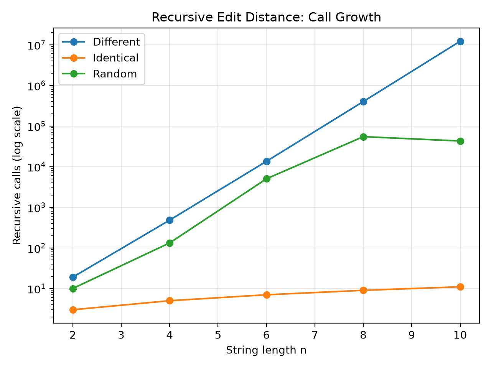
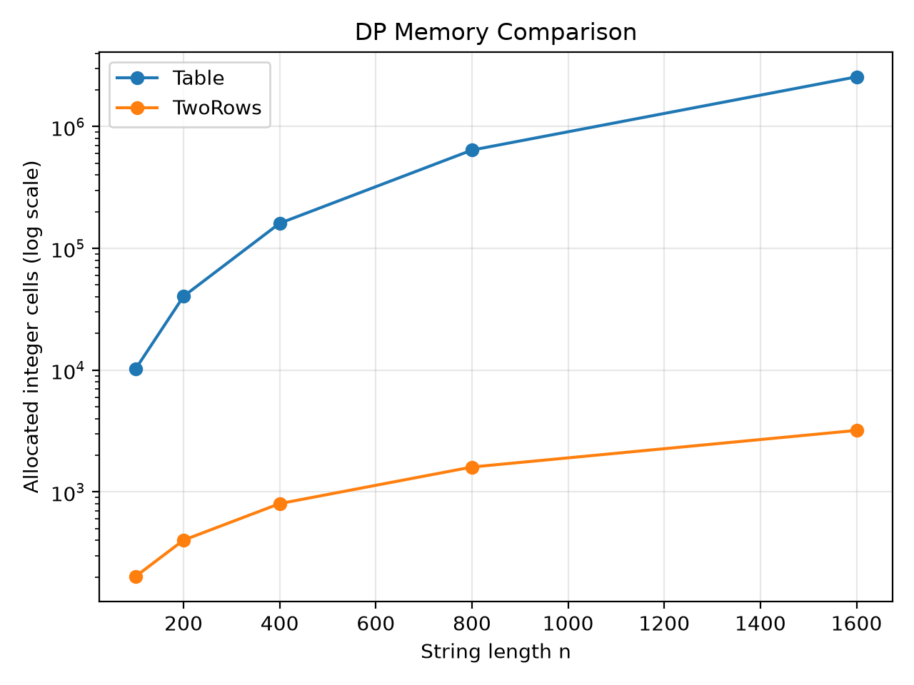
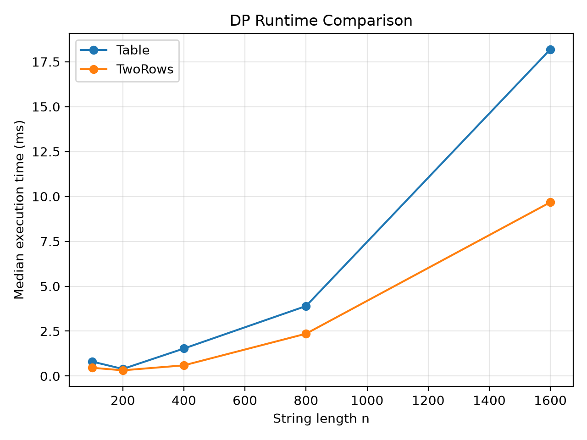
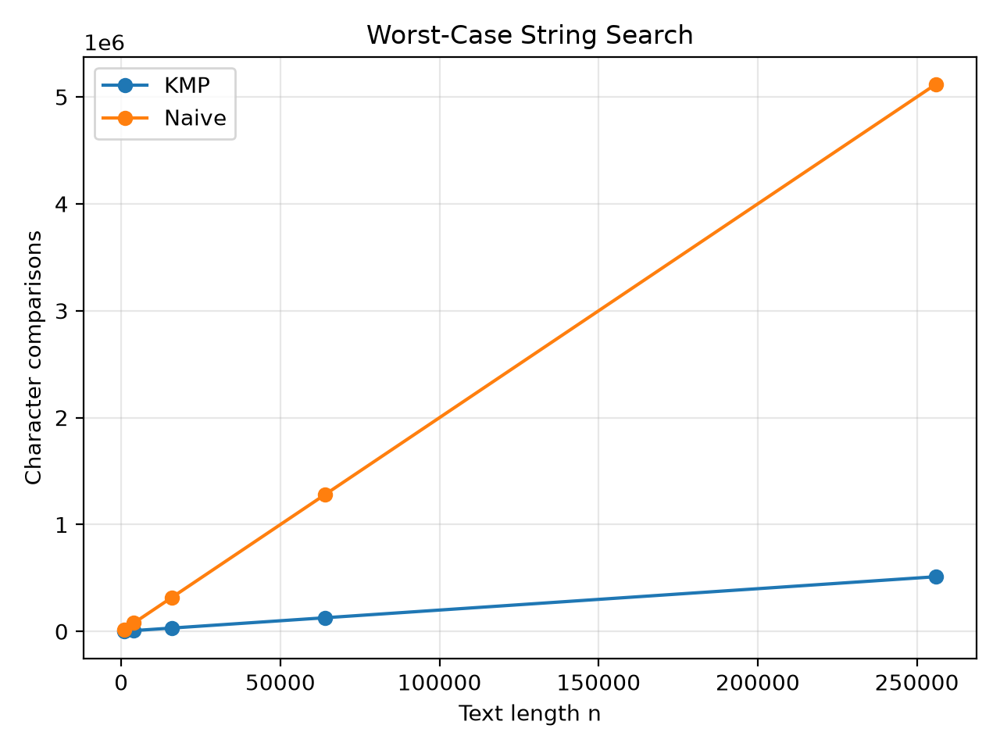
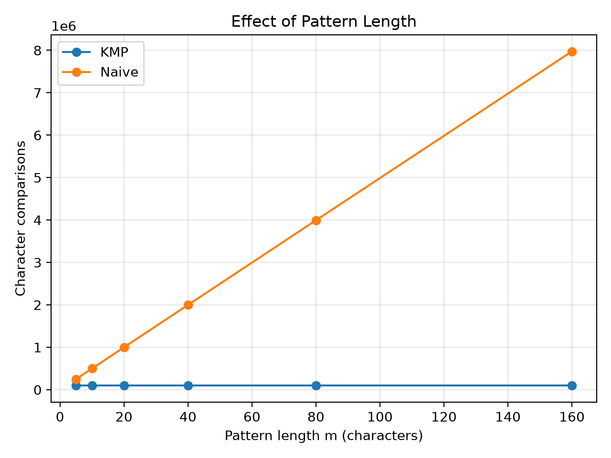

# Assignment 4 — Dynamic Programming and String Algorithms
## City Search & Spell-Check

## 1. Experiment Design Card

| Field | Design |
|---|---|
| **Questions** | **Edit Distance:** How do input structure and DP storage affect work, memory and runtime? **String search:** How do text length, pattern length and repetitive input affect Naive and KMP? |
| **Sizes** | Recursion: `n = 2, 4, 6, 8, 10`. Table and TwoRows: `n = 100, 200, 400, 800, 1600`, with `m = n`. Search: `n = 1000, 4000, 16000, 64000, 256000`, with `m = 20`. Pattern-length study: `m = 5, 10, 20, 40, 80, 160`, with `n = 50000`. Small recursive inputs control branching cost; larger DP/search inputs expose growth. |
| **Inputs and purpose** | Recursion: identical `A…A` strings expose the single-branch case; `A…A` versus `B…B` forces mismatch branching; random strings over `ABCD` show content-dependent work. DP uses different and random pairs. Search uses random input, all-`A` text with an `A…AB` pattern to force late mismatches, and all-`A` text/patterns to exercise overlapping results. |
| **Metrics** | Recursive helper calls, including base cases; non-base DP cell updates; allocated DP integer cells; search character comparisons, including KMP preprocessing; elapsed time in milliseconds, summarized by the median of five runs. |
| **Prediction** | Mismatch recursion grows exponentially, whereas identical inputs follow one branch. Both DP versions perform quadratic cell-update work for equal lengths, but TwoRows uses linear storage. Naive repeats long partial matches; KMP avoids restarting them. No universal runtime winner is assumed. |
| **Plots** | Recursive calls versus `n` (log Y); DP storage versus `n` (log Y); DP median time versus `n`; search comparisons versus `n`; search comparisons versus `m`. These separate input effects, memory savings, timing and the two search dimensions. |

**Design history.** This card consolidates the planning discussion and final settings; the final report was assembled after the runs. The initial recursive upper size of 12 was reduced to 10 conservatively, not following a measured failure. Overlapping search inputs and the pattern-length sweep extended the design. The memory plot later received a logarithmic Y-axis for readability.

## 2. Method and Evidence

The project uses the Java 17/Maven setup and JUnit 5. Each configuration receives two warm-up runs and five measured runs on the same generated input. Generation and validation are outside the timer; `System.nanoTime()` measures the instrumented algorithm, including its array/result allocation and KMP preprocessing. A fresh `Metrics` object is used for each run. The configured experiment has 77 configurations, giving 385 measured runs, with individual rows in `results/results.csv`.

The base seed is 42; size sweeps initialize the generator with `42 + n`. Identical seeds and call order reproduce inputs and counters, not elapsed times. Only one random input instance is generated per configuration: five timings are not five independent random samples.

The 45-test suite passed locally, including reference values, LPS arrays, edge cases, 100 random Edit Distance pairs and 100 random search cases. Benchmark validation compares Table with TwoRows and Naive with KMP; it does not independently compare recursive benchmark answers with DP answers.

**Evidence scope.** Observations below come from the five generated plots; graph-read numbers are approximate. Exact allocation figures are derived from the implementation's array dimensions. `allocated_cells` accounts for DP integer-array slots, not total JVM heap usage, object overhead or recursion-stack memory. DP update counts exclude base-case initialization.

## 3. Plots and Results

### Figure 1 — Recursive call growth

**Takeaway:** Different strings cause rapidly growing branching, whereas identical strings require only `n + 1` helper calls.

At `n = 10`, different strings exceed ten million calls, while identical strings require 11. The random curve decreases from `n = 8` to `n = 10`; these are different generated pairs, so the decrease is consistent with content-dependent branching rather than a monotonic average-case curve.

### Figure 2 — DP memory comparison

**Takeaway:** Full-table storage grows quadratically, while two-row storage grows linearly for equal-length strings.

At `n = 1600`, the allocation formulas give `(1601 × 1601) = 2,563,201` cells for Table and `2 × 1601 = 3,202` for TwoRows: a ratio of **800.5 to 1**, consistent with the graph. Both implementations calculate `n × m` non-base cells; the storage reduction does not eliminate those calculations.

### Figure 3 — DP runtime comparison

**Takeaway:** TwoRows has lower plotted median times on these inputs, although both algorithms retain quadratic cell-update work.

For the `Different` input at `n = 1600`, the graph shows approximately **18.2 ms** for Table and **9.7 ms** for TwoRows, about a **1.9×** runtime ratio. Reduced allocation and a smaller working set are plausible explanations, not measured causes. The dip between 100 and 200 does not establish that larger inputs are inherently faster.

### Figure 4 — Adversarial search, fixed pattern length

**Takeaway:** With `m = 20`, both comparison curves grow approximately linearly in text length, but Naive performs about ten times as many comparisons at the largest size.

At `n = 256000`, the graph shows roughly **5.12 million** Naive comparisons versus **0.512 million** for KMP, including LPS construction. Naive's adversarial count is analytically `(n − m + 1)m`; fixing `m` makes this linear in `n`. A comparison-count ratio is not a measured runtime speedup.

### Figure 5 — Varying pattern length

**Takeaway:** For fixed `n = 50000`, increasing `m` from 5 to 160 sharply increases Naive's work while KMP stays close to 100,000 comparisons.

Naive rises from approximately **250,000** to **7.97 million** comparisons. KMP's nearly flat line is consistent with its `O(n + m)` bound when `n` dominates the tested pattern lengths; it does not mean preprocessing is free or pattern length never matters.

## 4. Prediction versus Result and Timing Limitations

**Edit Distance:** The call and storage plots support the predicted branching and memory differences. TwoRows was also faster in the displayed DP measurements, but the experiment cannot attribute the improvement specifically to CPU caches. Different size ranges were used for recursion and DP, so their timings do not provide a same-size speedup comparison.

**String search:** The adversarial plots support the predicted comparison advantage of KMP. The pattern-length sweep reveals an effect hidden when `m` is fixed. These plots do not establish a runtime winner on random or overlapping inputs.

**Time:** The plotted DP medians generally rise at larger sizes, but small-input times are non-monotonic. Two warm-ups do not guarantee a fully warmed JVM; compilation, garbage collection and scheduling are possible influences that were not measured separately. Five-run medians reduce sensitivity to isolated outliers but do not remove systematic effects. Timings include instrumentation, algorithms run in a fixed order, and validation allocations may influence later execution even outside the timed interval. Counters therefore complement timing rather than replacing it, and no cache-specific or statistical-significance claim is made.

